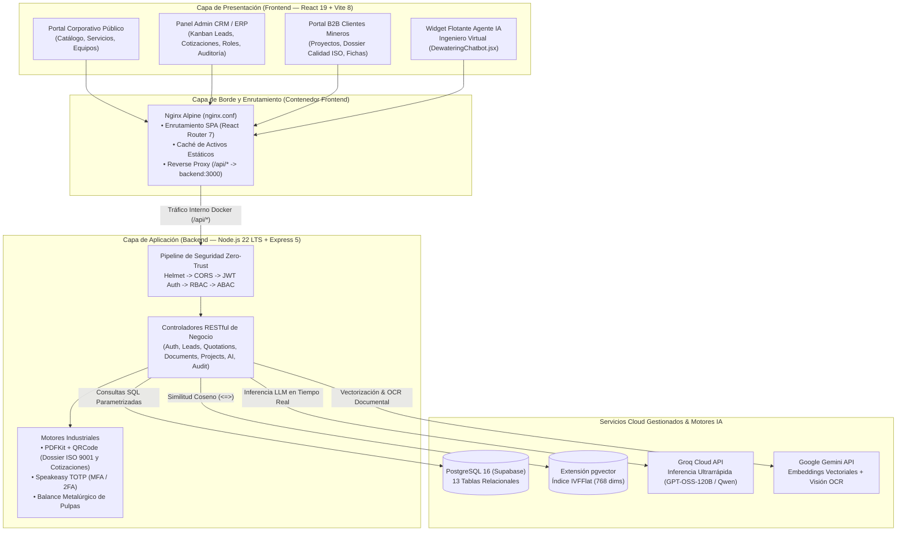
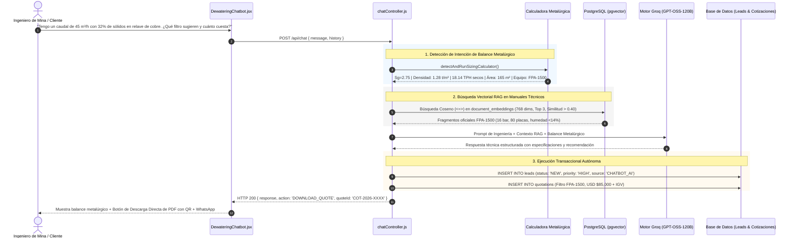
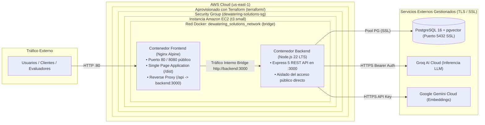

<div align="center">

# 💧 Dewatering Solutions Platform

### Ecosistema Industrial Full-Stack: Portal Corporativo · CRM/ERP · Portal B2B · Agente IA Transaccional (RAG) · Despliegue Cloud en AWS

[](https://aws.amazon.com/)
[](https://www.terraform.io/)
[](https://www.docker.com/)
[](https://nginx.org/)
[](https://nodejs.org/)
[](https://react.dev/)
[](https://expressjs.com/)
[](https://www.postgresql.org/)
[](https://groq.com/)

**Plataforma empresarial de ingeniería para Dewatering Solutions (Lima, Perú), especialista en separación sólido-líquido y filtración de relaves mineros bajo certificación internacional ISO 9001:2015.**

[Demo en Vivo](#-servidor-en-vivo-aws) • [Arquitectura General](#-arquitectura-general-del-sistema) • [Agente IA Transaccional](#-agente-ia-transaccional--ingeniero-virtual) • [Dossier de Calidad](#-dossier-de-calidad-industrial-turnover-package) • [Cloud & Terraform (AWS)](#-arquitectura-cloud--devops-aws) • [Seguridad Zero-Trust](#-seguridad-zero-trust-y-roles-rbac) • [Estructura](#-estructura-del-proyecto)

</div>

---

## 🌐 Servidor en Vivo (AWS)

La plataforma se encuentra actualmente desplegada y operativa en la nube de **Amazon Web Services (AWS)**:

* **URL Pública en Producción**: [http://13.222.164.169](http://13.222.164.169)
* **Instancia AWS**: Amazon EC2 `t3.small` (Ubuntu 24.04 LTS) — Región `us-east-1`
* **Orquestación**: Docker Compose con Nginx Reverse Proxy (`frontend`) y Node.js 22 Express (`backend`)
* **Aprovisionamiento**: Infraestructura como Código (IaC) automatizada con **Terraform**

---

## 🎯 Descripción General

**Dewatering Solutions Platform** unifica el ciclo comercial, técnico, operativo y de aseguramiento de calidad en una arquitectura moderna basada en contenedores:

1. **🌐 Portal Corporativo Público**: Catálogo técnico de **6 categorías metalúrgicas**, **13 servicios especializados de laboratorio y terreno**, y **6 líneas de equipos industriales** (Italia y Sudáfrica) con especificaciones técnicas detalladas en `JSONB` y captura directa de prospectos hacia el CRM.
2. **📊 Panel Administrativo CRM / ERP**: Tablero **Kanban de Leads** omnicanal con integración directa a **WhatsApp Business (`wa.me`)**, detección automática de prospectos captados por IA, motor de emisión de **Cotizaciones Oficiales en PDF con Sello QR y cálculo de IGV (18%)**, y gestión unificada de **Roles y Usuarios (`/roles`)** con protección contra autoeliminación.
3. **🏢 Portal B2B de Clientes Mineros**: Acceso privado para empresas del sector (Antamina, Cerro Verde, Marcobre - Mina Justa, Antapaccay, Minera Andina, etc.) para monitorear proyectos en curso y descargar **Dossieres de Calidad ISO 9001 (Turnover Package / Data Book)** con protocolos de ensayos no destructivos (NDT), pruebas hidrostáticas a 16 bar y trazabilidad criptográfica.
4. **🤖 Agente IA Transaccional ("Ingeniero Virtual")**: Asistente técnico impulsado por **Groq API** (`openai/gpt-oss-120b`, `qwen/qwen3.8-27b`) y búsqueda semántica vectorial de **768 dimensiones (`pgvector` + Gemini Embeddings)**. Integra **Calculadora Metalúrgica Autónoma** de balance de materia (caudal, % sólidos $C_p$, TPH secos, área de filtrado) y **emisión autónoma de pre-cotizaciones con descarga de PDF en el chat**.

---

## 🏗 Arquitectura General del Sistema



---

## 🤖 Agente IA Transaccional ("Ingeniero Virtual")

A diferencia de chatbots convencionales, el **Ingeniero Virtual** opera como un **Agente IA Transaccional con RAG Multimodal y Ejecución de Herramientas (*Function Calling*)**, configurado con baja temperatura (`temperature: 0.3`) para evitar alucinaciones en datos críticos de ingeniería minera:



### Capacidades Destacadas del Agente IA:
* **Calculadora Metalúrgica Integrada**: Resuelve en milisegundos balances de materia de pulpa: densidad de pulpa ($t/m^3$), tonelaje seco ($TPH$ y $TPD$), área de filtración requerida ($m^2$) y selección de equipo.
* **Emisión Transaccional de Cotizaciones**: Genera automáticamente cotizaciones formales con código correlativo, desglose de $IGV$ ($18\%$) y código $QR$ oficial.
* **Omnicanalidad WhatsApp**: Genera enlaces `wa.me` preformateados con el resumen técnico y número de cotización para contacto directo con ingeniería de ventas.

---

## 📑 Dossier de Calidad Industrial (Turnover Package)

En el sector minero, un **Dossier de Calidad (Data Book)** es un documento técnico-legal de auditoría (ISO 9001 / ASME / ASTM) que certifica que un equipo mayor intervenido o suministrado cumple con los protocolos de aseguramiento y control de calidad (QA/QC) y está liberado para operar.

En el **Portal del Cliente (`/client/documents`)**, la plataforma incluye descarga real de PDFs técnicos generados dinámicamente con `PDFKit` y `QRCode`:

```text
┌─────────────────────────────────────────────────────────────────────────────┐
│ DEWATERING SOLUTIONS S.A.C. — SISTEMA INTEGRADO DE GESTIÓN (ISO 9001:2015)  │
│ TURNOVER PACKAGE / DATA BOOK — CÓDIGO: DOS-CAL-2025-089-REV0                │
├─────────────────────────────────────────────────────────────────────────────┤
│ CLIENTE: Marcobre S.A.C. — Mina Justa (Ica, Perú)                           │
│ PROYECTO: PRJ-2025-089 (Overhaul Mayor y Comisionamiento Filtro Prensa)     │
│ EQUIPO: Tag 0310-FL-002 | Filtro Prensa de Membranas Automático FPA-1500    │
│ DICTAMEN FINAL: APROBADO Y LIBERADO SIN OBSERVACIONES (100% CONFORME)       │
├─────────────────────────────────────────────────────────────────────────────┤
│ PROTOCOLOS DE INSPECCIÓN Y ENSAYOS TÉCNICOS (QC LOG):                       │
│ • QC-NDT-001 (ASME Sec. V Art. 6): Líquidos penetrantes (Cero fisuras)      │
│ • QC-HYD-002 (ISO 10631 / ASME B31.3): Prueba hidrostática a 16.0 bar x 4h  │
│ • QC-DIM-003 (DIN 7129): Alineamiento láser de 120 placas (Desv. 0.35 mm)   │
│ • QC-TOR-004: Torque estructural a 450 Nm con torquímetro certificado       │
│ • QC-MET-005 (ASTM D2216): Humedad residual de queque lograda: 12.8% w/w    │
│ • QC-AUT-006 (ISA 88 / IEC 61131): Pruebas de lógica y lazos PLC S7-1500    │
├─────────────────────────────────────────────────────────────────────────────┤
│ TRAZABILIDAD: 120 placas PP virgen PPH, telas monofilamento, sellos Parker  │
│ FIRMAS: QA/QC Dewatering (CIP 184520) · Gerencia (CIP 142890) · Mina Justa  │
│ SEGURIDAD: Código QR dinámico + Hash de integridad criptográfico SHA-256    │
└─────────────────────────────────────────────────────────────────────────────┘
```

Adicionalmente, se incluyen descargas especializadas para:
* **`DOC-2026-101`**: Reporte Metalúrgico de Reología, Floculación y Sedimentación (Antapaccay).
* **`DOC-2026-088`**: Certificado de Calidad y Garantía de Fábrica (24 meses) para Placas Filtrantes.
* **`DOC-2026-052`**: Manual Técnico de Operación y Mantenimiento de Centrífuga Pusher.

---

## ☁️ Arquitectura Cloud & DevOps (AWS)

El despliegue en la nube utiliza **Amazon Web Services (AWS)** con arquitectura de contenedores Docker y automatización declarativa de infraestructura con **Terraform**:



### Infraestructura como Código con Terraform (`terraform/`):
* **`terraform/main.tf`**: Búsqueda dinámica de AMI oficial de Ubuntu 24.04 LTS, creación de par de claves SSH (`deployer`), configuración de Security Group con puertos autorizados (`80`, `443`, `8080`, `3000`, `22`), aprovisionamiento de volumen SSD `gp3` de 20 GB y script de arranque `user_data`.
* **`terraform/variables.tf`**: Variables parametrizadas y tipadas para tipo de instancia, región (`us-east-1`), claves de API y credenciales de base de datos protegidas con flag `sensitive = true`.

---

## 🔒 Seguridad Zero-Trust y Roles (RBAC)

El acceso a la plataforma está protegido por un modelo de **Defensa en Profundidad en 5 capas**:

1. **Protección Perimetral y Cabeceras**: `Helmet` (Content-Security-Policy, X-Frame-Options) y `CORS` configurado en el servidor y reverse proxy.
2. **Autenticación Criptográfica**: Contraseñas hasheadas con `bcrypt` (**12 rondas de sal**) y mitigación de fuerza bruta con bloqueo temporal por 15 minutos tras 5 intentos fallidos.
3. **Tokens de Sesión y MFA**: Tokens `JWT` (HS256) y soporte de autenticación en dos pasos (**2FA TOTP**) compatible con Google Authenticator (`speakeasy` + `qrcode`).
4. **Control de Acceso Basado en Roles (RBAC Unificado)**:
   * **`SUPER_ADMIN`**: Acceso total al sistema, Dashboard de KPIs, CRM Kanban, Cotizaciones, Centro de Entrenamiento IA (`/ai-training`), Gestión de Roles y Usuarios (`/roles`), y Pistas de Auditoría (`/audit`).
   * **`OPERATOR`**: Acceso operativo comercial y técnico: gestión del pipeline de Leads, actualización de estados de cotizaciones, seguimiento de proyectos y catálogo.
   * **`CLIENT`**: Acceso estrictamente restringido a su portal B2B privado: estado de proyectos propios, cotizaciones asociadas y descarga de dossieres de calidad.
5. **Auditoría Forense Inmutable (`audit_logs`)**: Captura forense automática de cada mutación de datos (`CREATE`, `UPDATE`, `DELETE`, `UPDATE_STATUS`) almacenando el usuario ejecutor, dirección IP, entidad afectada y la diferencia exacta en formato `JSONB` (`old_data` vs `new_data`).

---

## 🧪 Matriz de Credenciales para Demostración

| Rol de Sistema | Correo Corporativo | Contraseña Demo | Módulos Accesibles |
| :--- | :--- | :--- | :--- |
| **`SUPER_ADMIN`** | `admin@dewatering.com` | `Admin@2026` | Control Total: CRM Kanban, Cotizaciones con QR, Entrenamiento IA, Roles y Usuarios (`/roles`), Auditoría forense. |
| **`OPERATOR`** | `operador@dewatering.com` | `Operator@2026` | Operaciones: Tablero Kanban de Prospectos, Proyectos, Catálogo de Equipos y Cotizaciones. |
| **`CLIENT` (Minero)** | `cliente@empresa.com` | `Client@2026` | Portal B2B Minera Andina SAC: Monitoreo de proyectos y descarga del **Dossier de Calidad ISO 9001**. |

---

## 🗄 Modelo de Base de Datos (13 Tablas)

El esquema relacional completo se encuentra definido en [`database/database.sql`](database/database.sql):

1. **`users`**: Identidad de usuarios, credenciales hasheadas con bcrypt, roles (`SUPER_ADMIN`, `OPERATOR`, `CLIENT`), estado activo y configuración MFA.
2. **`service_categories`**: Las 6 divisiones metalúrgicas (*Filtración, Espesamiento, Flotación, Lixiviación, Pilotaje, Montaje*).
3. **`services`**: Catálogo de 13 ensayos de laboratorio y servicios especializados de campo.
4. **`products`**: Equipos industriales con especificaciones técnicas dinámicas en formato estructurado `JSONB`.
5. **`leads`**: Prospectos comerciales capturados por la web o autónomamente por el Agente IA en el pipeline Kanban.
6. **`quotations`**: Cotizaciones técnico-comerciales multimoneda (`USD`/`PEN`) con cálculo de IGV y numeración correlativa.
7. **`projects`**: Seguimiento post-venta y comisionamiento de proyectos en unidades mineras.
8. **`documents`**: Repositorio de fichas técnicas, manuales de equipo y dossieres de calidad industrial.
9. **`chatbot_conversations`**: Registro de sesiones del Ingeniero Virtual y fragmentos de contexto utilizados.
10. **`audit_logs`**: Bitácora inmutable de auditoría con instantáneas `old_data` y `new_data` en `JSONB`.
11. **`document_embeddings`**: Almacén vectorial `vector(768)` con índice `IVFFlat` para búsqueda semántica por similitud coseno.
12. **`stores`**: Sedes y sucursales operativas para control de jurisdicción por atributos (ABAC).
13. **`ai_training_jobs`**: Cola de procesamiento asíncrono para ingesta de documentos de entrenamiento IA (`PENDING` → `EXTRACTING` → `EMBEDDING` → `COMPLETED`).

---

## 📁 Estructura del Proyecto

```text
dewatering-platform/
├── backend/
│   ├── src/
│   │   ├── app.js                  # Configuración Express 5, Helmet, CORS y rutas API
│   │   ├── server.js               # Servidor HTTP resiliente y conexión al pool PostgreSQL
│   │   ├── config/
│   │   │   ├── db.js               # Conexión PG (pgvector) y fallback en memoria
│   │   │   └── supabase.js         # Cliente para ingesta de documentos
│   │   ├── controllers/            # Controladores de negocio (chat, quotation, document, lead...)
│   │   ├── middlewares/            # authMiddleware (JWT), rbacMiddleware, abacMiddleware
│   │   ├── models/                 # Modelos con consultas parametrizadas ($1, $2...)
│   │   ├── routes/                 # Enrutadores RESTful (/api/*)
│   │   └── services/               # Servicios de autenticación y auditoría inmutable
│   ├── scripts/migrations/         # Migraciones y seeding inicial del catálogo
│   ├── Dockerfile                  # Contenedor de producción Node.js 22 LTS Alpine
│   └── package.json
│
├── frontend/
│   ├── src/
│   │   ├── App.jsx                 # Enrutador principal React Router 7 y protección de rutas
│   │   ├── components/
│   │   │   ├── DashboardLayout.jsx # Layout del panel administrativo y navegación
│   │   │   ├── DewateringChatbot.jsx # Widget interactivo del Ingeniero Virtual IA
│   │   │   └── DewateringMascot.jsx  # Mascota interactiva en pantalla de Login
│   │   ├── context/AuthContext.jsx # Gestión global de estado de autenticación JWT
│   │   └── pages/
│   │       ├── public/             # Catálogo corporativo, servicios, contacto y login
│   │       ├── crm/                # Tablero Kanban de leads, cotizaciones con QR y auditoría
│   │       ├── client/             # Portal B2B cliente y descarga de Dossier de Calidad
│   │       ├── RolesPage.jsx       # Gestión unificada de usuarios, roles y contraseñas
│   │       └── AITrainingPage.jsx  # Centro de entrenamiento asíncrono de la IA
│   ├── Dockerfile                  # Multi-Stage Build (Node 22 Builder -> Nginx Alpine)
│   ├── nginx.conf                  # Configuración de Nginx Reverse Proxy y SPA routing
│   └── package.json
│
├── database/
│   └── database.sql                # Definición completa DDL (13 tablas + pgvector)
│
├── docker/
│   ├── docker-compose.yml          # Orquestación de producción (Frontend + Backend)
│   └── docker-compose.dev.yml      # Configuración de desarrollo local
│
├── terraform/
│   ├── main.tf                     # Aprovisionamiento EC2, Security Group y llaves SSH
│   ├── variables.tf                # Variables parametrizadas y secretos sensibles
│   └── outputs.tf                  # IP pública y DNS de la instancia AWS
│
└── docs/
    ├── GUION_EXPOSICION.md         # Guion estructurado palabra por palabra para sustentación
    ├── DOCUMENTACION_EXPO_Y_AWS.md # Guía técnica de arquitectura, comandos y preguntas frecuentes
    ├── API_DOCUMENTATION.md        # Documentación de endpoints REST
    └── PROJECT_CONTEXT.md          # Contexto comercial e identidad técnica de la empresa
```

---

## 🚀 Despliegue Rápido Local (Docker)

```bash
# 1. Clonar el repositorio
git clone https://github.com/0xhazroot/dewatering-solutions.git
cd dewatering-solutions

# 2. Levantar los contenedores con Docker Compose
cd docker
docker compose up -d --build

# 3. Acceder a la plataforma
# Portal Web: http://localhost:80
# API Backend: http://localhost:80/api/health
```

---

## 📄 Licencia

Este proyecto es **software propietario** desarrollado para **Dewatering Solutions S.A.C.** (Lima, Perú). Todos los derechos reservados.

<div align="center">

**Ingeniería Peruana Especializada en Separación Sólido-Líquido para la Minería**  
*Dewatering Solutions S.A.C. — Certificación ISO 9001:2015*

</div>
