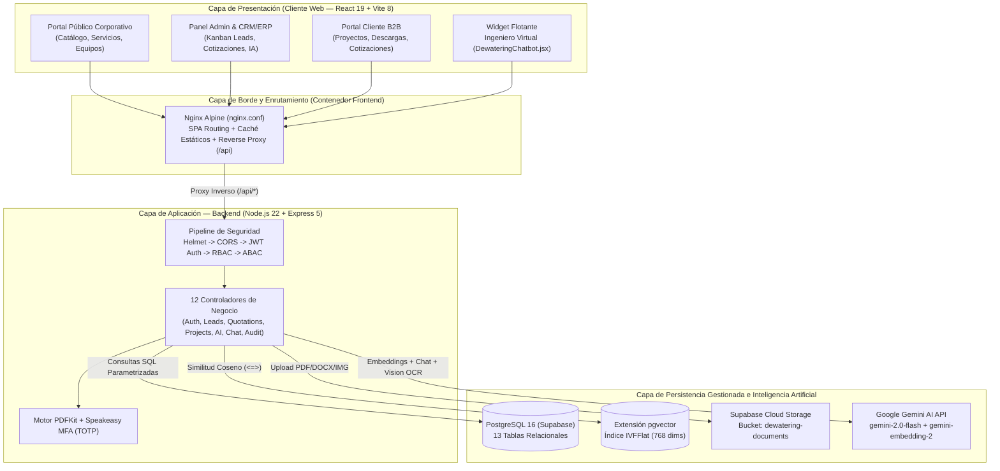
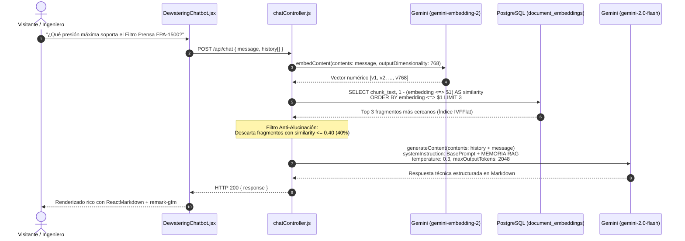
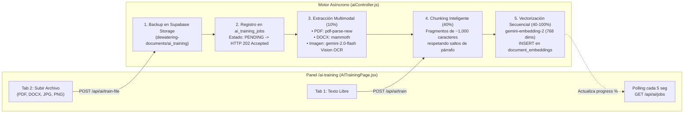
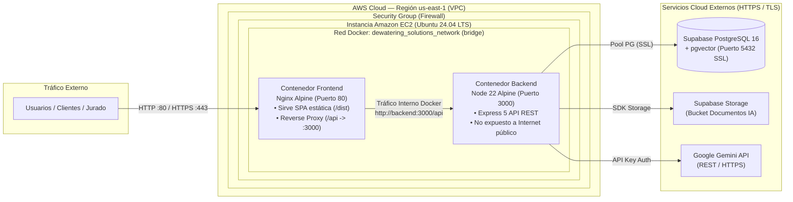
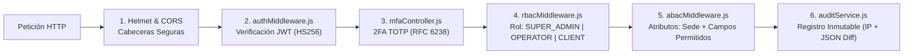

<div align="center">

# 💧 Dewatering Solutions Platform

### Ecosistema Industrial Full-Stack: Portal Corporativo · CRM/ERP · Portal B2B · Chatbot IA (RAG)

[](https://aws.amazon.com/)
[](https://www.docker.com/)
[](https://nginx.org/)
[](https://nodejs.org/)
[](https://react.dev/)
[](https://expressjs.com/)
[](https://www.postgresql.org/)
[](https://ai.google.dev/)

**Plataforma empresarial diseñada para Dewatering Solutions (Lima, Perú), especialista en ingeniería de separación sólido-líquido para el sector minero e industrial bajo certificación ISO 9001.**

[Arquitectura](#-arquitectura-general-del-sistema) • [Chatbot IA (RAG)](#-arquitectura-del-chatbot-ia-ingeniero-virtual) • [Cloud & DevOps (AWS)](#-arquitectura-cloud--devops-aws) • [Seguridad Zero-Trust](#-seguridad-zero-trust-y-auditoría) • [Pruebas & QA](#-pruebas-health-checks-y-qa) • [Estructura](#-estructura-del-proyecto)

</div>

---

## 🎯 Descripción General

**Dewatering Solutions Platform** unifica el ciclo comercial, operativo y de soporte técnico de ingeniería en una arquitectura distribuida en contenedores:

1. **🌐 Portal Corporativo Público**: Catálogo de **6 categorías metalúrgicas**, **13 servicios especializados**, **6 líneas de equipos industriales** (Italia y Sudáfrica) con especificaciones técnicas en `JSONB`, y formularios de contacto conectados en tiempo real al pipeline del CRM.
2. **📊 Panel Administrativo CRM / ERP**: Dashboard ejecutivo con KPIs en vivo, tablero **Kanban de Leads** (`NEW` → `CONTACTED` → `EVALUATING` → `PROPOSAL` → `NEGOTIATION` → `WON`/`LOST`), motor de cotizaciones con generación de **PDF multimoneda (`PEN`/`USD`)**, gestión de sucursales, inventario y personal.
3. **🏢 Portal B2B para Clientes Mineros**: Entorno aislado donde compañías mineras (Antamina, Cerro Verde, Las Bambas, Antapaccay, Minera Andina, etc.) consultan el estado de sus proyectos post-venta, aprueban cotizaciones y descargan certificados o dossieres de calidad.
4. **🤖 "Ingeniero Virtual" — Chatbot IA con RAG Multimodal**: Asistente técnico impulsado por **Google Gemini (`gemini-2.0-flash`)** y búsqueda vectorial semántica de **768 dimensiones (`gemini-embedding-2` + `pgvector`)**, con panel administrativo de entrenamiento asíncrono para textos, PDFs, documentos Word e imágenes técnicas (OCR).

---

## 🏗 Arquitectura General del Sistema



---

## 🤖 Arquitectura del Chatbot IA ("Ingeniero Virtual")

El módulo de IA evita respuestas genéricas o alucinaciones mediante una arquitectura **RAG (*Retrieval-Augmented Generation*) Multimodal** dividida en dos flujos independientes: **Inferencia Conversacional** e **Ingestión Asíncrona de Conocimiento**.

### 1. Flujo de Inferencia y Búsqueda Vectorial en Tiempo Real (`POST /api/chat`)



#### Especificaciones Técnicas del Motor RAG
* **Dimensiones del Espacio Vectorial**: `768` dimensiones generadas por `gemini-embedding-2`.
* **Índice Vectorial en Base de Datos**: `IVFFlat` con operador de distancia coseno (`vector_cosine_ops`, `lists = 100`).
* **Umbral de Relevancia Semántica (*Threshold*)**: `similarity > 0.40`. Si la consulta no tiene coincidencia suficiente en la base documental, no contamina el contexto.
* **Comportamiento Híbrido del Prompt (`temperature: 0.3`)**:
  * **Ingeniería General**: Autorizado para resolver cálculos matemáticos, dimensionamiento metalúrgico y balances sólido-líquido.
  * **Datos Corporativos y Equipos**: Restringido **exclusivamente** a los fragmentos recuperados en la `"MEMORIA RAG ENCONTRADA"`.

---

### 2. Pipeline de Entrenamiento Multimodal en Segundo Plano (`/ai-training`)



---

## ☁️ Arquitectura Cloud & DevOps (AWS)

La infraestructura de despliegue en **Amazon Web Services (AWS)** utiliza orquestación de contenedores Docker sobre **Amazon EC2** con una red bridge aislada (`dewatering_solutions_network`), delegando la capa de estado (base de datos vectorial y almacenamiento de objetos) a servicios gestionados en la nube para garantizar alta disponibilidad y persistencia.



### Diseño de Contenedores (Docker Multi-Stage)

| Servicio | Imagen Base | Estrategia de Construcción | Puerto Interno | Exposición |
| :--- | :--- | :--- | :--- | :--- |
| **`frontend`** | `node:22-alpine` → `nginx:alpine` | **Multi-Stage Build**: La Etapa 1 compila el bundle estático con Vite (`npm ci && npm run build`) y la Etapa 2 copia únicamente `/app/dist` hacia Nginx, reduciendo la imagen final a ~45 MB. | `80` | Público (`80` / `8080`) |
| **`backend`** | `node:22-alpine` | Imagen ligera de producción ejecutando `npm ci` determinista y levantando Express en `0.0.0.0:3000` con tolerancia a desconexiones temporales de red. | `3000` | Red interna Docker |

### Despliegue Rápido con Docker Compose (Local / AWS EC2)

**1. Configurar variables de entorno del Backend (`backend/.env`):**
```env
PORT=3000
NODE_ENV=production

# Base de Datos PostgreSQL 16 + pgvector (Supabase)
DB_HOST=tu_host_supabase.supabase.co
DB_PORT=5432
DB_USER=postgres
DB_PASSWORD=tu_password_seguro
DB_NAME=postgres

# Supabase Storage (Documentos y Entrenamiento IA)
SUPABASE_URL=https://tu_proyecto.supabase.co
SUPABASE_SERVICE_ROLE_KEY=tu_service_role_key

# Seguridad Zero-Trust
JWT_SECRET=tu_secreto_jwt_256_bits

# Inteligencia Artificial (Google Gemini)
GEMINI_API_KEY=tu_api_key_de_gemini
```

**2. Construir y levantar los contenedores:**
```bash
cd docker
docker compose up -d --build
```

**3. Comandos de operación y monitoreo DevOps:**
```bash
# Verificar estado de los contenedores
docker compose ps

# Inspeccionar logs en tiempo real del backend y conexión a PostgreSQL
docker compose logs -f backend

# Reiniciar un servicio sin tiempo de inactividad prolongado
docker compose restart backend
```

---

## 🔒 Seguridad Zero-Trust y Auditoría

El sistema implementa un modelo de **Defensa en Profundidad** a través de 5 anillos de seguridad:



* **Autenticación y Cifrado**: Contraseñas hasheadas con `bcrypt` (**12 rondas de sal**) y bloqueo automático de cuenta por **15 minutos** tras **5 intentos fallidos**.
* **MFA / 2FA (TOTP)**: Enrolamiento mediante código QR compatible con **Google Authenticator** (`speakeasy` + `qrcode`).
* **RBAC Simplificado**: 3 roles estrictos (`SUPER_ADMIN`, `OPERATOR`, `CLIENT`).
* **ABAC (Control Basado en Atributos)**:
  * `hasStoreJurisdiction`: Valida que un operador solo modifique recursos de su sucursal asignada.
  * `denyAuditorWrites`: Garantiza permisos de solo lectura para clientes externos.
  * `restrictEmployeeFields`: Filtra a nivel de propiedad qué columnas puede actualizar un operador.
* **Audit Trail Inmutable (`audit_logs`)**: Captura `user_id`, `action`, `entity`, `ip_address`, `old_data` (`JSONB`) y `new_data` (`JSONB`).

---

## 🧪 Pruebas, Health Checks y QA

### 1. Verificación de Salud del Servicio (Health Check)
El backend expone un endpoint de diagnóstico continuo para balanceadores de carga y monitoreo en AWS:
```bash
curl -i http://localhost:3000/api/health
```
Respuesta esperada (`HTTP 200 OK`):
```json
{
  "status": "ok",
  "message": "Dewatering Solutions API is running.",
  "version": "1.0.0",
  "endpoints": [
    "/api/auth", "/api/users", "/api/leads", "/api/quotations",
    "/api/services", "/api/products", "/api/projects", "/api/documents", "/api/audit"
  ]
}
```

### 2. Scripts de Semilla (Seeding) y Pruebas de Base de Datos
Ubicados en `backend/scripts/migrations/`:
```bash
# Poblar catálogo completo (6 categorías, 13 servicios, 6 equipos, leads y usuarios demo)
cd backend
node scripts/migrations/seed_dewatering.js
```

### 3. Matriz de Credenciales para Pruebas QA / Demo

| Rol | Usuario | Contraseña | Alcance de Prueba |
| :--- | :--- | :--- | :--- |
| **`SUPER_ADMIN`** | `admin@dewatering.com` | `Admin@2026` | Acceso total: Dashboard, CRM Kanban, Cotizaciones PDF, Entrenamiento IA (`/ai-training`), Personal y Auditoría (`/audit`). |
| **`CLIENT` (B2B)** | `contacto@minera-andina.com` | `Client@2026` | Portal B2B Minera Andina: visualización aislada de proyectos, cotizaciones y descarga de fichas técnicas. |
| **`CLIENT` (B2B)** | `gerencia@antapaccay.com` | `Client@2026` | Portal B2B Antapaccay: validación de aislamiento multi-cliente (ABAC). |

---

## 🗄 Modelo de Base de Datos (13 Tablas)

Definido íntegramente en [`database/database.sql`](database/database.sql):

1. **`users`**: Credenciales, perfil corporativo, rol (`SUPER_ADMIN`, `OPERATOR`, `CLIENT`) y estado MFA.
2. **`service_categories`**: Las 6 divisiones técnicas (*Filtración, Espesamiento, Flotación, Lixiviación, Pilotaje, Montaje*).
3. **`services`**: Los 13 ensayos metalúrgicos y servicios de campo.
4. **`products`**: Equipos industriales con especificaciones técnicas dinámicas en `JSONB`.
5. **`leads`**: Prospectos comerciales captados en la web y gestionados en el pipeline Kanban.
6. **`quotations`**: Cotizaciones versionadas con ítems en `JSONB`, impuestos y soporte multimoneda (`PEN`/`USD`).
7. **`projects`**: Seguimiento de ejecución de proyectos post-venta.
8. **`documents`**: Fichas técnicas, certificados ISO y documentos base del conocimiento RAG (`RAG_KNOWLEDGE`).
9. **`chatbot_conversations`**: Historial de interacciones del asistente virtual y fuentes utilizadas.
10. **`audit_logs`**: Bitácora forense de cambios con instantáneas `old_data` y `new_data`.
11. **`document_embeddings`**: Almacén vectorial `vector(768)` indexado con `IVFFlat` para búsqueda por similitud coseno.
12. **`stores`**: Sucursales operativas para reglas de jurisdicción geográfica ABAC.
13. **`ai_training_jobs`**: Cola asíncrona de procesamiento de archivos de entrenamiento IA (`PENDING` → `EXTRACTING` → `EMBEDDING` → `COMPLETED` / `FAILED`).

---

## 📁 Estructura del Proyecto

```text
dewatering-platform/
├── backend/
│   ├── src/
│   │   ├── app.js                  # Configuración de Express 5, CORS, Helmet y rutas
│   │   ├── server.js               # Inicialización resiliente del servidor y pool PG
│   │   ├── config/
│   │   │   ├── db.js               # Pool PostgreSQL (max: 20 conexiones, SSL)
│   │   │   └── supabase.js         # Cliente Supabase Storage para ingesta de archivos
│   │   ├── controllers/            # 12 controladores (ai, chat, auth, mfa, quotation, lead...)
│   │   ├── middlewares/            # authMiddleware, rbacMiddleware, abacMiddleware
│   │   ├── models/                 # 8 modelos con consultas SQL parametrizadas
│   │   ├── routes/                 # 11 routers RESTful (/api/*)
│   │   ├── services/               # authService.js y auditService.js
│   │   └── utils/                  # Utilidades criptográficas y TOTP (mfaUtils.js)
│   ├── scripts/migrations/         # Scripts de migración y seed (seed_dewatering.js)
│   ├── Dockerfile                  # Imagen de producción Node 22 Alpine
│   └── package.json
│
├── frontend/
│   ├── src/
│   │   ├── App.jsx                 # Enrutador React Router 7 + ProtectedRoute RBAC
│   │   ├── components/
│   │   │   ├── DashboardLayout.jsx # Layout administrativo con sidebar dinámico
│   │   │   ├── DewateringChatbot.jsx # Widget flotante del Ingeniero Virtual (Markdown)
│   │   │   ├── DewateringMascot.jsx  # Mascota interactiva en Login
│   │   │   └── public/PublicLayout.jsx # Layout corporativo público
│   │   ├── context/AuthContext.jsx # Estado global de sesión JWT y permisos
│   │   ├── pages/                  # 25 vistas (public/, crm/, client/, AITrainingPage...)
│   │   └── services/api.js         # Instancia Axios con interceptores JWT y 401
│   ├── Dockerfile                  # Multi-stage build (Node 22 Builder -> Nginx Alpine)
│   ├── nginx.conf                  # Configuración SPA + caché + Reverse Proxy
│   └── package.json
│
├── database/
│   └── database.sql                # Esquema completo (13 tablas + extensión pgvector)
│
├── docker/
│   ├── docker-compose.yml          # Orquestación de producción (Frontend + Backend)
│   └── docker-compose.dev.yml      # Orquestación de entorno de desarrollo
│
└── docs/
    ├── DOCUMENTACION_EXPO_Y_AWS.md # Guía técnica detallada para exposición y despliegue AWS
    ├── API_DOCUMENTATION.md        # Referencia de endpoints REST
    └── PROJECT_CONTEXT.md          # Contexto de negocio e identidad visual
```

---

## 📄 Licencia

Este proyecto es **software propietario** desarrollado como proyecto de pre-tesis universitaria e implementación empresarial para **Dewatering Solutions**. Todos los derechos reservados.

<div align="center">

**Desarrollado para la industria minera y metalúrgica del Perú**  
*Dewatering Solutions — Especialistas en Separación Sólido-Líquido*

</div>
