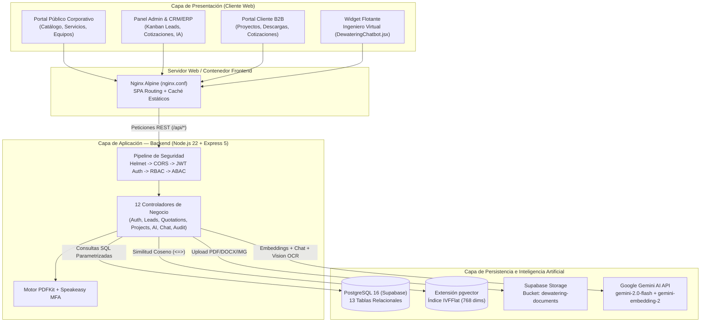
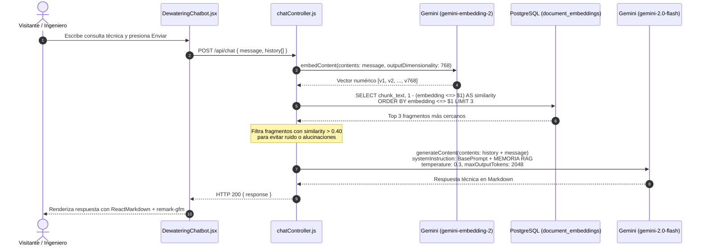
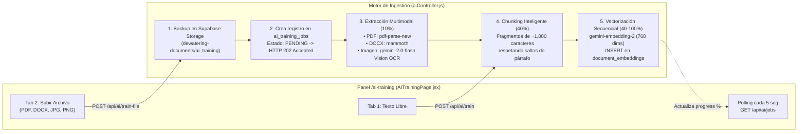

# 📘 Documentación Técnica Integral: Dewatering Solutions Platform
### Guía Oficial de Arquitectura, Chatbot IA (RAG) y Despliegue en AWS para Exposición

---

## 1. Resumen Ejecutivo y Contexto del Proyecto

**Dewatering Solutions Platform** es un ecosistema empresarial Full-Stack que integra en una sola plataforma:
1. **Portal Corporativo Público**: Catálogo técnico interactivo de servicios metalúrgicos, equipos industriales, portafolio de proyectos y captación automatizada de prospectos (*Leads*).
2. **Sistema Interno CRM / ERP**: Gestión de prospectos en tablero Kanban, motor de generación de cotizaciones con exportación a PDF multimoneda (`PEN` / `USD`), control de inventario, sucursales y seguimiento de proyectos post-venta.
3. **Portal B2B de Clientes**: Entorno privado de autogestión donde empresas mineras e industriales consultan sus proyectos activos, aprueban cotizaciones y descargan certificados o manuales técnicos.
4. **Asistente Técnico con Inteligencia Artificial ("Ingeniero Virtual")**: Chatbot especializado con arquitectura **RAG (*Retrieval-Augmented Generation*) Multimodal** sobre **PostgreSQL (`pgvector`)** y **Google Gemini**, entrenado con documentos técnicos propios de la empresa.

> **Datos de la Empresa Cliente (Dewatering Solutions):**
> Fundada en 2017 en Lima, Perú. Especialista en soluciones de **separación sólido-líquido** (filtración, espesamiento, flotación, lixiviación, pilotajes y montaje industrial) para la gran y mediana minería (Antamina, Cerro Verde, Las Bambas, Buenaventura, Chinalco, Southern, Sedapal). Cuenta con certificación **ISO 9001** y alianzas con fabricantes de **Italia y Sudáfrica**.

---

## 2. Stack Tecnológico y Métricas del Código Fuente

### 2.1. Matriz Tecnológica (Versiones Reales en Producción)

| Capa | Tecnología | Versión | Propósito Técnico en el Proyecto |
| :--- | :--- | :--- | :--- |
| **Frontend UI** | React + Vite | `19.2.5` / `8.0.10` | SPA reactiva con renderizado concurrente y empaquetado optimizado (`frontend/package.json`). |
| **Enrutamiento** | React Router DOM | `7.15.0` | Enrutamiento cliente con guardias de seguridad `ProtectedRoute` por rol (`frontend/src/App.jsx`). |
| **Visualización y UI** | Recharts + Lucide + SweetAlert2 | `3.8.1` / `1.14.0` | Gráficos analíticos de KPIs en Dashboard, iconografía industrial y alertas modales. |
| **Renderizado Chat** | `react-markdown` + `remark-gfm` | `10.1.0` / `4.0.1` | Formateo de respuestas técnicas del Chatbot (tablas, listas, fórmulas y negritas). |
| **Backend Runtime** | Node.js (ES Modules) + Express | `>=22.0.0` / `5.2.1` | API RESTful asíncrona con soporte nativo de promesas en middlewares (`backend/package.json`). |
| **Motor de IA y RAG** | `@google/genai` (Google Gemini) | `2.9.0` | Generación conversacional (`gemini-2.0-flash`), OCR de imágenes y embeddings (`gemini-embedding-2`). |
| **Procesamiento Docs** | `pdf-parse-new` + `mammoth` + `multer` | `2.1.0` / `1.12.0` | Extracción de texto desde archivos PDF y Word (`.docx`) en memoria para entrenamiento RAG. |
| **Generación Documental**| `pdfkit` + `qrcode` | `0.19.1` / `1.5.4` | Creación dinámica de cotizaciones oficiales en PDF y códigos QR para enrolamiento MFA. |
| **Seguridad y Auth** | `jsonwebtoken` + `bcrypt` + `speakeasy` | `9.0.3` / `6.0.0` / `2.0.0` | Tokens JWT (`HS256`), hashing de contraseñas (12 rondas de sal) y segundo factor TOTP (RFC 6238). |
| **Base de Datos** | PostgreSQL + `pgvector` + Supabase | `16` / `8.20.0` | Almacenamiento relacional, búsqueda vectorial de 768 dimensiones y bucket de archivos en la nube. |
| **Infraestructura** | Docker + Nginx Alpine | Multi-stage | Contenerización aislada para Frontend (puerto `80`/`8080`) y Backend (puerto `3000`). |

### 2.2. Inventario Cuantitativo del Proyecto
* **Vistas del Frontend**: **25 páginas** distribuidas en `frontend/src/pages/` (`public/`, `crm/`, `client/` y administración general).
* **Controladores del Backend**: **12 controladores** en `backend/src/controllers/`.
* **Modelos de Datos**: **8 modelos** en `backend/src/models/` con consultas SQL 100% parametrizadas (`$1, $2...`) contra inyección SQL.
* **Enrutadores REST**: **11 módulos de rutas** registrados en `backend/src/app.js` más endpoints de Health Check (`/api/health`) y KPIs consolidados (`/api/dashboard`).
* **Esquema de Base de Datos**: **13 tablas** en `database/database.sql` (11 operativas/CRM + 2 de vectores/entrenamiento IA).

---

## 3. Arquitectura del Sistema y Estructura de Directorios



---

## 4. Funcionamiento Detallado del Chatbot IA ("Ingeniero Virtual")

El módulo de Inteligencia Artificial combina **búsqueda vectorial semántica en PostgreSQL (`pgvector`)**, **ingesta multimodal asíncrona** y **generación controlada con Google Gemini**.

### 4.1. Arquitectura de Inferencia en Tiempo Real (Consulta del Usuario)

* **Frontend**: `frontend/src/components/DewateringChatbot.jsx`
* **Ruta**: `backend/src/routes/chatRoutes.js` (`POST /api/chat`)
* **Controlador**: `backend/src/controllers/chatController.js`



#### Parámetros Técnicos Exactos del Chatbot:
1. **Modelo de Embeddings**: `gemini-embedding-2` configurado explícitamente con `outputDimensionality: 768`.
2. **Métrica de Distancia Vectorial**: Distancia Coseno mediante el operador `<=>` de `pgvector`. La similitud se calcula como `1 - (embedding <=> $1)`.
3. **Top-K y Umbral de Corte (*Similarity Threshold*)**:
   * Recupera los **Top 3** fragmentos (`LIMIT 3`).
   * Aplica un filtro estricto en memoria (`row.similarity > 0.4`). Si ningún documento supera el **40% de similitud semántica**, el sistema indica `(No se encontraron documentos específicos. Usa tu conocimiento general)`.
4. **Regla de Negocio Híbrida del System Prompt**:
   * **Conocimiento Abierto de Ingeniería**: Puede resolver cálculos matemáticos, dimensionamiento de caudales/pulpas y consultas metalúrgicas generales.
   * **Candado Corporativo (Cero Alucinación)**: Ante cualquier pregunta sobre **Dewatering Solutions, sus equipos o documentos privados**, está obligado a responder **exclusivamente con la Memoria RAG**. Si el dato no figura en los vectores recuperados, instruye al usuario a contactar al equipo comercial.
5. **Hiperparámetros de Generación**:
   * Modelo generativo: **`gemini-2.0-flash`**.
   * Temperatura: **`0.3`** (alta fidelidad técnica, baja creatividad especulativa).
   * Límite de salida: **`2048` tokens**.

---

### 4.2. Centro de Entrenamiento e Ingestión Multimodal en Segundo Plano

* **Frontend**: `frontend/src/pages/AITrainingPage.jsx` (Ruta `/ai-training`)
* **Ruta**: `backend/src/routes/aiRoutes.js` (`/api/ai/*`)
* **Controlador**: `backend/src/controllers/aiController.js`



#### Detalles Clave del Entrenamiento:
1. **Algoritmo de Fragmentación (`chunkText`)**:
   * Divide el documento por saltos de línea (`\n`) agrupando párrafos completos hasta alcanzar un máximo de **`1,000` caracteres por fragmento** (descartando fragmentos residuales menores a 10 caracteres).
   * En el panel de administración, el sistema calcula los tokens aproximados de cada documento mediante la fórmula `chunks * 250`.
2. **Extracción Multimodal (Texto, Documentos y Visión Artificial)**:
   * **PDF (`application/pdf`)**: Procesado en memoria (`file.buffer`) mediante `pdf-parse-new`.
   * **Word (`.docx` / `.doc`)**: Extracción de texto limpio con `mammoth.extractRawText`.
   * **Imágenes Técnicas (`image/png`, `image/jpeg`)**: Se envían en `base64` a **`gemini-2.0-flash`** con el prompt: *"Extrae todo el texto técnico y datos de esta imagen con la mayor precisión posible. Formatea como texto limpio"*, permitiendo entrenar al bot incluso con **fotos de placas de equipos, tablas escaneadas o diagramas**.
3. **Procesamiento Asíncrono No Bloqueante (`HTTP 202 Accepted`)**:
   * Al subir un archivo pesado, `trainFromFile` lo respalda en Supabase Storage, registra un job en `ai_training_jobs`, responde inmediatamente `202 Accepted` y ejecuta `processBackgroundTraining` en segundo plano actualizando la barra de progreso en tiempo real.

---

## 5. Modelo de Base de Datos (13 Tablas en PostgreSQL + `pgvector`)

El esquema completo reside en `database/database.sql`:

| # | Tabla | Clave Primaria | Descripción y Campos Clave |
| :- | :--- | :--- | :--- |
| **1** | `users` | `UUID` | Usuarios del sistema (`email`, `password_hash`, `role` [`SUPER_ADMIN`, `OPERATOR`, `CLIENT`], campos MFA y bloqueo). |
| **2** | `service_categories` | `SERIAL` | Las 6 líneas de negocio (`Filtración`, `Espesamiento`, `Flotación`, `Lixiviación`, `Pilotaje`, `Montaje`). |
| **3** | `services` | `SERIAL` | Los 13 servicios técnicos ofrecidos, vinculados a `service_categories(id)`. |
| **4** | `products` | `SERIAL` | Catálogo de equipos industriales con `specifications` en formato **`JSONB`**, `origin` (`Italia`/`Sudáfrica`) y `datasheet_url`. |
| **5** | `leads` | `SERIAL` | Prospectos comerciales del CRM con estado de pipeline (`NEW`, `CONTACTED`, `EVALUATING`, `PROPOSAL`, `NEGOTIATION`, `WON`, `LOST`) y prioridad. |
| **6** | `quotations` | `SERIAL` | Cotizaciones vinculadas a `leads(id)`, con número único (`COT-2026-XXXX`), `items` (`JSONB`), `subtotal`, `tax`, `total` y `currency` (`PEN`/`USD`). |
| **7** | `projects` | `SERIAL` | Proyectos post-venta vinculados a `quotations(id)` y `client_id` (`PLANNING`, `IN_PROGRESS`, `ON_HOLD`, `COMPLETED`, `CANCELLED`). |
| **8** | `documents` | `SERIAL` | Repositorio de fichas técnicas, certificados y documentos maestros de conocimiento IA (`category = 'RAG_KNOWLEDGE'`). |
| **9** | `chatbot_conversations`| `SERIAL` | Bitácora diseñada para almacenar sesiones de conversación, fuentes RAG (`JSONB`) y feedback. |
| **10**| `audit_logs` | `SERIAL` | Registro inmutable de seguridad (`user_id`, `action`, `entity`, `old_data` `JSONB`, `new_data` `JSONB`, `ip_address`). |
| **11**| `document_embeddings` | `SERIAL` | Tabla vectorial con columna **`embedding vector(768)`**, `chunk_text`, `metadata` (`JSONB`) e índice **`idx_embeddings_vector` (`IVFFlat`)**. |
| **12**| `stores` | `SERIAL` | Sedes/sucursales operativas (ej. Lima, Callao) utilizadas para validación de jurisdicción en **ABAC**. |
| **13**| `ai_training_jobs` | `SERIAL` | Cola de trabajos de entrenamiento en segundo plano (`file_name`, `file_url`, `status`, `progress` `0-100`, `error_message`). |

---

## 6. Arquitectura de Seguridad (Defensa en Profundidad)

1. **Autenticación Robusta y Políticas de Cuenta (`authService.js`)**:
   * Contraseñas cifradas con `bcrypt` (**12 rondas de sal**).
   * Tokens **JWT (`HS256`)** con expiración de **8 horas**, sin secretos por defecto (*zero fallback secret*).
   * Protección contra fuerza bruta: bloqueo temporal de cuenta tras **5 intentos fallidos** durante **15 minutos**.
2. **Autenticación Multifactor (MFA / TOTP) (`mfaController.js`)**:
   * Implementa el estándar **RFC 6238 (TOTP)** mediante `speakeasy` y genera códigos QR en base64 con `qrcode` para vincular con **Google Authenticator** o **Authy**.
3. **Autorización Híbrida RBAC + ABAC**:
   * **RBAC (`rbacMiddleware.js`)**: Verifica el rol principal del JWT (`SUPER_ADMIN`, `OPERATOR`, `CLIENT`).
   * **ABAC (`abacMiddleware.js`)**: Evalúa atributos dinámicos de contexto:
     * `hasStoreJurisdiction`: Un operador solo administra recursos de su sede asignada; `SUPER_ADMIN` tiene alcance global.
     * `denyAuditorWrites`: Bloquea mutaciones (`POST`, `PUT`, `DELETE`) para perfiles de solo lectura (`CLIENT`).
     * `restrictEmployeeFields`: Impide que un `OPERATOR` modifique atributos sensibles no autorizados en el payload.
4. **Trazabilidad Completa (Audit Trail) (`auditService.js`)**:
   * Cada operación crítica invoca `auditService.log(req, action, entity, id, oldData, newData)` almacenando la instantánea previa y posterior en PostgreSQL.

---

## 7. Catálogo de Endpoints REST y Credenciales Demo

### 7.1. Rutas Principales del Backend (`backend/src/app.js`)

| Prefijo de Ruta | Archivo Enrutador | Funcionalidades Principales | Acceso |
| :--- | :--- | :--- | :--- |
| `/api/auth` | `authRoutes.js` | Login, registro, perfil `/me`, recuperación de clave y flujo completo MFA (`/mfa/setup`, `/mfa/enable`, `/mfa/validate`). | Público / JWT |
| `/api/chat` | `chatRoutes.js` | Endpoint conversacional `POST /api/chat` conectado a Gemini + `pgvector`. | Público |
| `/api/ai` | `aiRoutes.js` | Entrenamiento RAG: `POST /train`, `POST /train-file`, `GET /trained-docs`, `GET /jobs`, `DELETE /trained-docs/:id`. | `SUPER_ADMIN` |
| `/api/leads` | `leadRoutes.js` | Captación desde web pública (`POST /`) y gestión del pipeline Kanban CRM (`GET`, `PUT`, `PATCH /:id/status`). | Público (`POST`) / RBAC |
| `/api/quotations`| `quotationRoutes.js`| CRUD de cotizaciones, cambio de estado y generación de PDF descargable (`GET /:id/pdf`). | RBAC (`SUPER_ADMIN`, `OPERATOR`, `CLIENT`) |
| `/api/projects` | `projectRoutes.js` | Gestión de proyectos post-venta e indicadores de estado. | RBAC |
| `/api/services` | `serviceRoutes.js` | Catálogo de categorías y los 13 servicios metalúrgicos. | Público (`GET`) / Admin |
| `/api/products` | `productRoutes.js` | Catálogo de equipos industriales y especificaciones JSONB. | Público (`GET`) / RBAC + ABAC |
| `/api/documents` | `documentRoutes.js` | Gestión documental de fichas técnicas, reportes y certificados. | Público / RBAC |
| `/api/users` | `userRoutes.js` | Administración de personal, asignación de roles y activación/bloqueo de cuentas. | `SUPER_ADMIN` |
| `/api/audit` | `auditRoutes.js` | Consulta filtrable de logs de auditoría y estadísticas de seguridad. | `SUPER_ADMIN` |

### 7.2. Usuarios de Prueba (Seed Oficial en `seed_dewatering.js`)

| Correo Electrónico | Contraseña | Rol / Perfil | Uso Recomendado en la Demostración |
| :--- | :--- | :--- | :--- |
| `admin@dewatering.com` | `Admin@2026` | `SUPER_ADMIN` | Mostrar Dashboard completo, Kanban CRM, Entrenamiento IA (`/ai-training`), Personal y Auditoría (`/audit`). |
| `contacto@minera-andina.com` | `Client@2026` | `CLIENT` | Mostrar el Portal B2B del cliente minero (`/client/projects`, `/client/quotations`, `/client/documents`). |
| `gerencia@antapaccay.com` | `Client@2026` | `CLIENT` | Segundo cliente B2B para demostrar aislamiento de datos entre empresas mineras. |

---

## 8. Guía Paso a Paso para Levantar el Proyecto en AWS

Para tu exposición del martes, la arquitectura más sólida, rápida y económica es **AWS EC2 (Ubuntu 24.04) + Docker Compose**, manteniendo la base de datos PostgreSQL + `pgvector` y el Storage en **Supabase**.

### Paso 1: Configuración de Red y Proxy Inverso en Docker (Ya Aplicado ✅)

Los archivos [`frontend/.env.production`](file:///c:/pretesis-haziel/dewatering-platform/frontend/.env.production) y [`frontend/nginx.conf`](file:///c:/pretesis-haziel/dewatering-platform/frontend/nginx.conf) ya están configurados para que el contenedor de Nginx en AWS sirva tanto el Frontend como el Backend bajo la misma IP pública o dominio (sin errores de CORS):

**1. Configuración en `frontend/.env.production`:**
```env
VITE_API_URL=/api
```

**2. Proxy Inverso `/api/` en `frontend/nginx.conf`:**
```nginx
server {
    listen 80;
    server_name localhost;
    client_max_body_size 20M;

    # Proxy inverso hacia el contenedor del Backend en la red de Docker
    location /api/ {
        proxy_pass http://backend:3000/api/;
        proxy_http_version 1.1;
        proxy_set_header Upgrade $http_upgrade;
        proxy_set_header Connection 'upgrade';
        proxy_set_header Host $host;
        proxy_set_header X-Real-IP $remote_addr;
        proxy_set_header X-Forwarded-For $proxy_add_x_forwarded_for;
        proxy_cache_bypass $http_upgrade;
    }

    location / {
        root /usr/share/nginx/html;
        index index.html index.htm;
        try_files $uri $uri/ /index.html;
    }

    location ~* \.(?:ico|css|js|gif|jpe?g|png|webp|woff2?|eot|ttf|svg)$ {
        root /usr/share/nginx/html;
        expires 6M;
        access_log off;
        add_header Cache-Control "public";
    }
}
```

**3. Actualizar el puerto en `docker/docker-compose.yml` (opcional para entrar directo sin `:8080`):**
Cambia `"8080:80"` por `"80:80"` en el servicio `frontend`.

---

### Paso 2: Crear la Instancia en AWS EC2

1. Entra a **AWS Console → EC2 → Launch Instance**.
2. **Nombre**: `dewatering-platform-prod`.
3. **AMI (Sistema Operativo)**: **Ubuntu Server 24.04 LTS (HVM), SSD Volume Type**.
4. **Instance Type**: `t3.small` (2 vCPU, 2 GB RAM) o `t3.medium`.
5. **Key Pair**: Crea o selecciona tu llave `.pem` para conectarte por SSH.
6. **Network Settings (Security Group)**:
   * Habilita **Allow SSH traffic from** (Puerto `22`).
   * Habilita **Allow HTTP traffic from the internet** (Puerto `80`).
   * Habilita **Allow HTTPS traffic from the internet** (Puerto `443`).
   * *(Opcional)* Si mantienes el puerto `8080` en `docker-compose.yml`, abre una regla **Custom TCP Port `8080`** desde `0.0.0.0/0`.
7. **Storage**: `20 GB gp3`.

---

### Paso 3: Comandos en la Terminal de AWS EC2

Conéctate por SSH a tu instancia EC2 y ejecuta estos bloques en orden:

```bash
# 1. Actualizar paquetes e instalar Docker + Docker Compose plugin
sudo apt-get update && sudo apt-get upgrade -y
sudo apt-get install -y ca-certificates curl git
sudo install -m 0755 -d /etc/apt/keyrings
sudo curl -fsSL https://download.docker.com/linux/ubuntu/gpg -o /etc/apt/keyrings/docker.asc
sudo chmod a+r /etc/apt/keyrings/docker.asc

echo \
  "deb [arch=$(dpkg --print-architecture) signed-by=/etc/apt/keyrings/docker.asc] https://download.docker.com/linux/ubuntu \
  $(. /etc/os-release && echo "$VERSION_CODENAME") stable" | \
  sudo tee /etc/apt/sources.list.d/docker.list > /dev/null

sudo apt-get update
sudo apt-get install -y docker-ce docker-ce-cli containerd.io docker-buildx-plugin docker-compose-plugin
sudo usermod -aG docker ubuntu
newgrp docker
```

```bash
# 2. Clonar tu repositorio y crear el archivo backend/.env
git clone https://github.com/0xhazroot/dewatering-solutions.git
cd dewatering-solutions

nano backend/.env
```

Pega tus variables reales dentro de `backend/.env`:
```env
PORT=3000
NODE_ENV=production

# Credenciales PostgreSQL (Supabase)
DB_HOST=db.exkjyjfcgndhwwdytioa.supabase.co
DB_PORT=5432
DB_USER=postgres
DB_PASSWORD=TU_PASSWORD_DE_SUPABASE
DB_NAME=postgres

# Supabase Storage
SUPABASE_URL=https://exkjyjfcgndhwwdytioa.supabase.co
SUPABASE_SERVICE_ROLE_KEY=TU_SUPABASE_KEY

# Seguridad JWT
JWT_SECRET=TU_SECRETO_JWT_ROBUSTO

# Inteligencia Artificial (Google Gemini)
GEMINI_API_KEY=TU_GEMINI_API_KEY
```

```bash
# 3. Construir y levantar los contenedores en segundo plano
cd docker
docker compose up -d --build

# 4. Verificar que ambos contenedores estén corriendo y ver logs
docker compose ps
docker compose logs -f backend
```

---

## 9. Guion Rápido y Preguntas Clave para tu Exposición del Martes

### Flujo de Demostración en Vivo Sugerido (5 a 7 minutos)
1. **Minuto 1 — Portal Corporativo y Captación**: Abre la Landing Page, muestra el catálogo de servicios de filtración/espesamiento y equipos importados de Italia/Sudáfrica, y envía una solicitud desde `/contacto`.
2. **Minuto 2 — El "Ingeniero Virtual" (Chatbot RAG)**: Abre el widget flotante de la mascota y hazle una pregunta técnica específica sobre un equipo de Dewatering Solutions y luego un cálculo de ingeniería. Explica cómo consulta los vectores de **768 dimensiones** en `pgvector`.
3. **Minuto 3 — Seguridad y Login con MFA**: Inicia sesión como `admin@dewatering.com`, destacando el flujo de autenticación JWT + TOTP (Google Authenticator) y el modelo **RBAC + ABAC**.
4. **Minuto 4 — CRM Kanban y Cotización PDF**: Entra a `/leads`, muestra el prospecto recién creado en el tablero Kanban, genera una cotización en dólares (`USD`) o soles (`PEN`) y descarga el **PDF oficial en vivo**.
5. **Minuto 5 — Centro de Entrenamiento IA (`/ai-training`)**: Sube un PDF, Word o imagen técnica en vivo. Muestra cómo el backend responde `202 Accepted` y la barra de progreso en segundo plano vectoriza el documento con `gemini-embedding-2`.
6. **Minuto 6 — Auditoría Inmutable (`/audit`)**: Muestra cómo todas las acciones anteriores quedaron registradas con IP, fecha y el *diff* JSON de antes/después.

